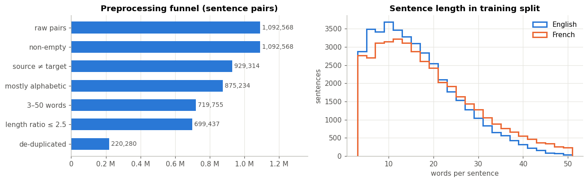
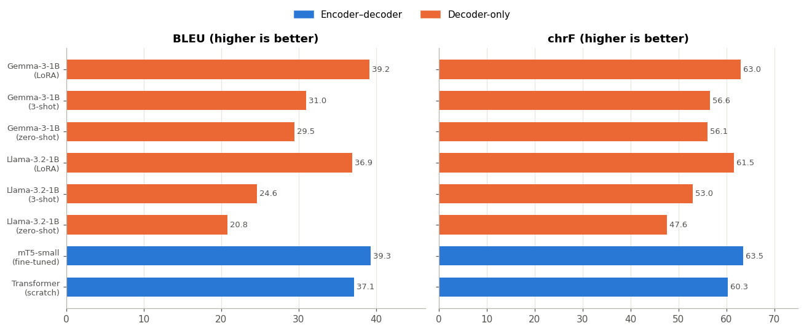
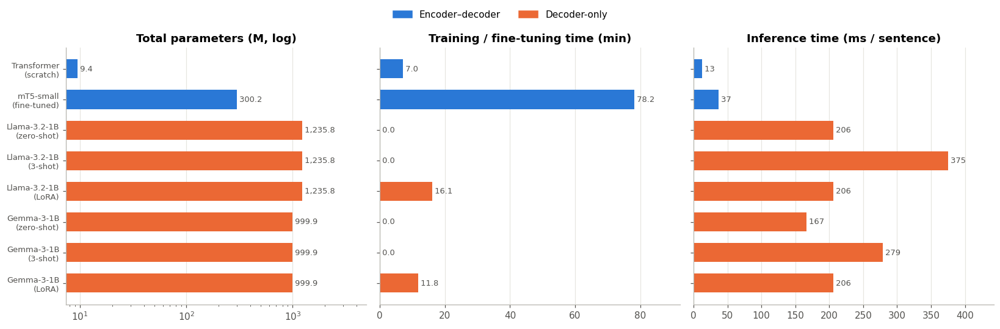
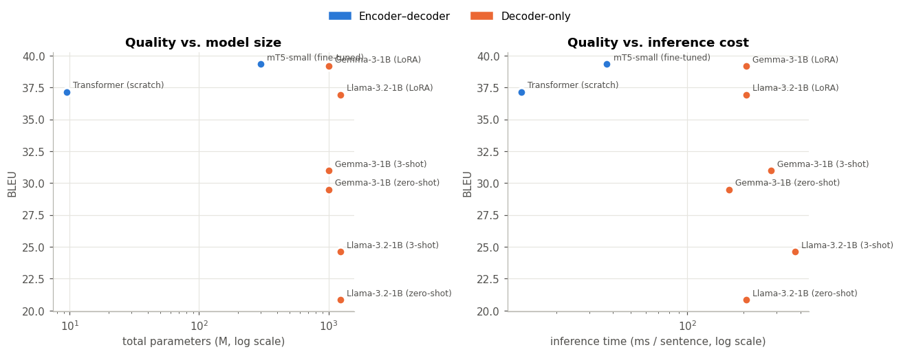
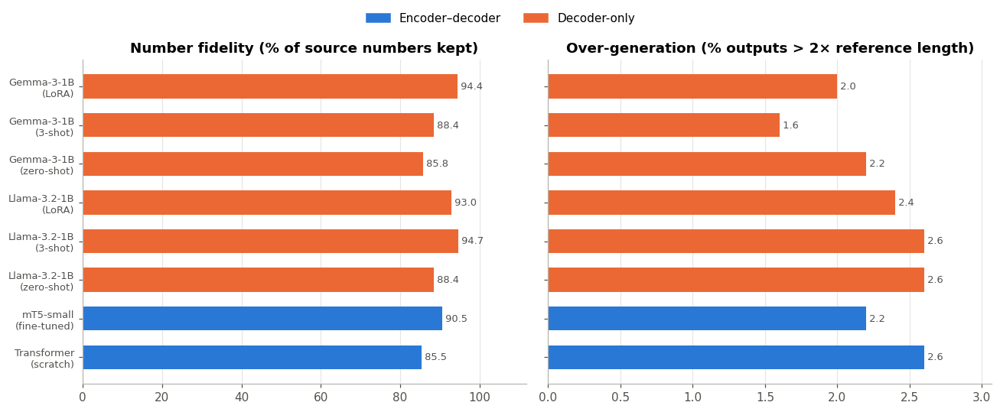
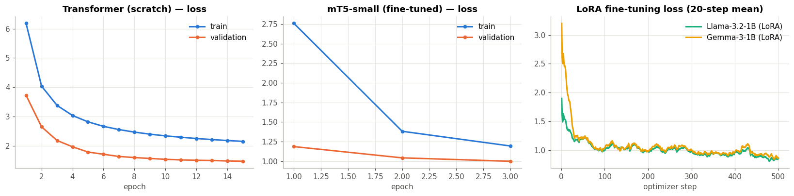
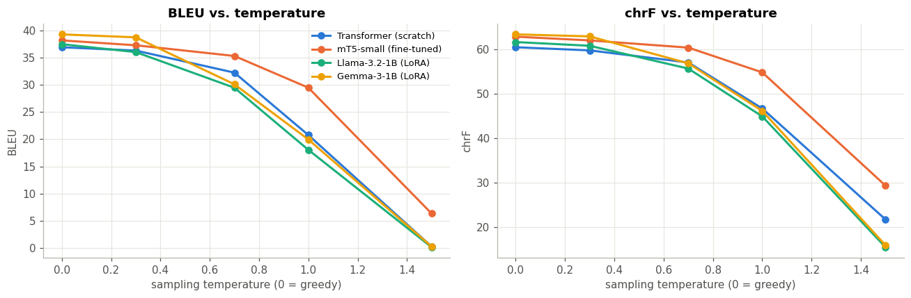

# MediTrans-FR — English → French Biomedical Machine Translation

**Foundations of Generative AI (ICT4403) — Assignment 3**

Comparing **encoder–decoder** and **decoder-only** Transformers on medical translation: a Transformer trained from scratch, fine-tuned **mT5**, and **LLaMA** and **Gemma** adapted with prompting and LoRA. All are evaluated on the same test set from the European Medicines Agency (EMEA) corpus.

| Best BLEU / chrF | Most efficient | Biggest gain from adaptation |
|---|---|---|
| **mT5-small (fine-tuned): 39.32 / 63.49**, practically tied with Gemma-3-1B + LoRA (39.19 / 63.01) | **Transformer from scratch:** 37.14 BLEU with only 9.4 M parameters, 7 min of training and 13 ms per sentence | **LLaMA-3.2-1B:** 20.83 BLEU zero-shot → 36.92 BLEU with LoRA (**+16.1**) |

---

## 1. Problem statement and objective

Medical documents such as package leaflets, dosage instructions and side-effect warnings must be available in every patient's language. A mistranslated dose, a dropped negation or an invented sentence can cause real harm, so medical machine translation (MT) has to be both **accurate** and **trustworthy**.

**Objective.** Build English → French translation systems with four Transformer families and compare:

1. translation quality (**BLEU**, **chrF**),
2. computational cost (**parameters**, **training/fine-tuning time**, **inference time**),
3. the effect of **architecture** (encoder–decoder vs. decoder-only), **model size**, **pre-training**, **tokenisation** and **adaptation method** (from scratch / full fine-tuning / prompting / LoRA),
4. behaviour under **sampling temperature**, and
5. **responsible-AI risks**: gender bias, hallucination, cultural misrepresentation and sensitive health content.

## 2. Dataset

| | |
|---|---|
| **Name** | EMEA v3 (European Medicines Agency parallel corpus), English–French, from OPUS |
| **Source link** | <https://opus.nlpl.eu/opusapi/?corpus=EMEA&source=en&target=fr&preprocessing=moses&version=v3> |
| **Direct download** | <https://object.pouta.csc.fi/OPUS-EMEA/v3/moses/en-fr.txt.zip> |
| **Dataset card** | <https://huggingface.co/datasets/Helsinki-NLP/emea> |
| **Content** | Sentence-aligned Summaries of Product Characteristics, patient leaflets and European Public Assessment Reports of EU-authorised medicines |
| **Size (raw)** | 1,092,568 sentence pairs, 12.2 M English / 14.1 M French tokens |
| **Citation** | J. Tiedemann (2012). *Parallel Data, Tools and Interfaces in OPUS.* LREC 2012 |

**Preprocessing** (notebook §1.1):

| Step | Pairs left |
|---|---:|
| Raw pairs | 1,092,568 |
| Non-empty | 1,092,568 |
| Source ≠ target (removes untranslated codes and names) | 929,314 |
| Mostly alphabetic (removes reference numbers and table cells) | 875,234 |
| 3–50 words on both sides | 719,755 |
| Length ratio ≤ 2.5 (removes misalignments) | 699,437 |
| **De-duplicated on the English side** | **220,280** |

Further cleaning steps:
- Unicode NFC normalisation and whitespace clean-up.
- Removal of the stray space EMEA puts after French elisions (*"l’ efficacité"* → *"l’efficacité"*), so models that write correct French are not penalised.
- De-duplication. EMEA repeats the same boilerplate sentences thousands of times; without this step, test sentences would also appear in training.

After shuffling (seed 42), the splits are:

| Split | Pairs | Avg. EN / FR words | Use |
|---|---:|---|---|
| Train | 39,845 | 16.0 / 17.9 | Transformer & mT5 training; first 4,000 used for LoRA |
| Validation | 1,000 | 16.1 / 18.0 | Validation loss / early stopping |
| Test | 500 | 16.8 / 18.5 | Final evaluation of **all** systems |

155 training pairs whose English or French side also appears in validation or test were removed (leakage check). The splits are saved in [data/](data/).



## 3. Models

| # | System | Architecture | Parameters | Adaptation | Tokeniser |
|---|---|---|---:|---|---|
| 1 | **Transformer (scratch)** | Encoder–decoder (Vaswani et al., 2017): 4+4 layers, d_model 256, 4 heads, FFN 1024, pre-LayerNorm, shared embeddings | 9.4 M | Trained from scratch: 15 epochs, label smoothing 0.1, Noam warm-up, fp16 | Joint EN+FR SentencePiece BPE (8 k), learned on our training data |
| 2 | **mT5-small** (`google/mt5-small`) | Encoder–decoder, pre-trained on mC4 (101 languages) with span corruption, *not* on translation | 300 M | Full fine-tuning: 3 epochs, AdamW 5e-4, fp32 | mT5 SentencePiece (250 k) |
| 3 | **Llama-3.2-1B-Instruct** (`unsloth/Llama-3.2-1B-Instruct`) | Decoder-only, instruction-tuned | 1,236 M | (a) zero-shot prompt, (b) 3-shot prompt, (c) **LoRA** r=16/α=32 on all attention+MLP projections, 1 epoch on 4 k pairs | Llama-3 BPE (128 k) |
| 4 | **Gemma-3-1B-it** (`unsloth/gemma-3-1b-it`) | Decoder-only, instruction-tuned | 1,000 M | (a) zero-shot, (b) 3-shot, (c) **LoRA** (same settings) | Gemma-3 SentencePiece (262 k) |

The Unsloth repositories are **ungated copies with the same weights** as `meta-llama/Llama-3.2-1B-Instruct` and `google/gemma-3-1b-it`. For LLaMA and Gemma, the prompt is the model's own chat template with the instruction *"Translate the following English sentence from a medical document into French. Reply with the French translation only."* During LoRA training, the loss is computed only on the French answer tokens, and the adapters are merged into the model before inference.

**Comparable settings.**
- All eight systems translate the **same 500 test sentences**.
- Decoding is **greedy** with **at most 128 new tokens**.
- Scores use **sacreBLEU** (corpus BLEU, 13a tokenisation; chrF) on detokenised output.
- All systems ran on the same hardware: Kaggle **Tesla T4 (16 GB)**, PyTorch 2.11, transformers 5.16.1, peft 0.20.

## 4. Repository structure

```
├── MediTrans_FR_EN_FR_Medical_MT.ipynb   # full implementation, executed on Kaggle (with outputs)
├── README.md
├── requirements.txt
├── data/                                  # train / val / test splits (TSV)
├── submission/                            # Word document for the LMS
└── results/
    ├── metrics.csv                        # main comparison table
    ├── diagnostics.csv                    # tokenisation + reliability metrics
    ├── temperature.csv                    # sampling-temperature analysis
    ├── summary.json, state.json           # all raw results (incl. loss curves, probe outputs)
    ├── sample_translations.md             # test-set examples from every system
    ├── ethics_probes.md                   # responsible-AI probe translations
    ├── translations/                      # full test-set output of every system (500 lines each)
    ├── kaggle_run_log_version2.txt        # log of the final Kaggle run
    └── plots/                             # all figures
```

## 5. Execution steps and dependencies

**Dependencies:** Python ≥ 3.10, `torch`, `transformers` (≥ 4.56, for Gemma 3), `peft`, `accelerate`, `sentencepiece`, `sacrebleu`, `pandas`, `numpy`, `matplotlib`, `tabulate` (see [requirements.txt](requirements.txt)). The first notebook cell installs anything that is missing.

**Kaggle (used for the reported results; free T4 GPU, runs in the background):**
1. <https://www.kaggle.com/code> → *New Notebook* → *File → Import Notebook* → upload `MediTrans_FR_EN_FR_Medical_MT.ipynb`.
2. Right panel → *Session options*: *Accelerator = GPU T4 x2*, *Internet = On* (needs a phone-verified account).
3. *Save Version → Save & Run All (Commit)*. The browser can be closed. When it finishes, `meditrans_fr_results.zip`, `results/` and `data/` are in the version's *Output* tab.
4. **Resuming:** every finished section is recorded in `results/state.json`. If a run stops, attach the previous version's output as an *Input* and commit again; finished sections are skipped. The reported results come from two commits of the same notebook: Version 1 trained the Transformer and mT5, and Version 2 resumed from its output for LLaMA and Gemma, after a library conflict (an old `torchao` rejected by `peft`) was fixed.

**Google Colab (free T4 GPU):** *Runtime → Change runtime type → T4 GPU* → *Run all* and allow Google Drive access. All files are kept in `MyDrive/MediTrans_FR`, so after a disconnect just run all cells again.

**Total compute:** about 7 min (Transformer) + 78 min (mT5) + 16 min (LLaMA LoRA) + 12 min (Gemma LoRA) of training, plus inference and the temperature sweeps. That's about 2.5 GPU-hours in total.

## 6. Results

### 6.1 Main comparison (500 test sentences, greedy decoding)

| System | Architecture | Adaptation | **BLEU** | **chrF** | Params (M) | Trained params (M) | Train time (min) | Inference, test set (s) | ms / sentence |
|---|---|---|---:|---:|---:|---:|---:|---:|---:|
| Transformer (scratch) | Encoder–decoder | Trained from scratch | 37.14 | 60.31 | 9.4 | 9.4 | 7.0 | 6.5 | **13** |
| **mT5-small** | Encoder–decoder | Full fine-tuning | **39.32** | **63.49** | 300.2 | 300.2 | 78.2 | 18.6 | 37 |
| Llama-3.2-1B | Decoder-only | Zero-shot prompting | 20.83 | 47.62 | 1,235.8 | 0 | 0 | 103.2 | 206 |
| Llama-3.2-1B | Decoder-only | 3-shot prompting | 24.62 | 53.03 | 1,235.8 | 0 | 0 | 187.5 | 375 |
| Llama-3.2-1B | Decoder-only | LoRA fine-tuning | 36.92 | 61.55 | 1,235.8 | 11.3 (0.9 %) | 16.1 | 103.0 | 206 |
| Gemma-3-1B | Decoder-only | Zero-shot prompting | 29.49 | 56.07 | 999.9 | 0 | 0 | 83.4 | 167 |
| Gemma-3-1B | Decoder-only | 3-shot prompting | 30.96 | 56.57 | 999.9 | 0 | 0 | 139.3 | 279 |
| Gemma-3-1B | Decoder-only | LoRA fine-tuning | 39.19 | 63.01 | 999.9 | 13.1 (1.3 %) | 11.8 | 103.0 | 206 |





### 6.2 Tokenisation and reliability diagnostics

| System | Tokens/word EN | Tokens/word FR | Number fidelity % | Over-generation % | Copied source % | Length ratio |
|---|---:|---:|---:|---:|---:|---:|
| Transformer (scratch) | 1.51 | **1.60** | 85.5 | 2.6 | 0.4 | 1.05 |
| mT5-small | 1.72 | 2.03 | 90.5 | 2.2 | 1.0 | 1.05 |
| Llama-3.2-1B (zero-shot) | 1.47 | 1.92 | 88.4 | 2.6 | **2.4** | 0.94 |
| Llama-3.2-1B (3-shot) | 1.47 | 1.92 | **94.8** | 2.6 | 0.4 | 1.05 |
| Llama-3.2-1B (LoRA) | 1.47 | 1.92 | 93.0 | 2.4 | 0.6 | 1.04 |
| Gemma-3-1B (zero-shot) | 1.44 | 1.68 | 85.8 | 2.2 | 1.2 | 1.01 |
| Gemma-3-1B (3-shot) | 1.44 | 1.68 | 88.4 | **1.6** | 0.6 | 0.98 |
| Gemma-3-1B (LoRA) | 1.44 | 1.68 | 94.4 | 2.0 | 1.6 | 1.11 |

The columns mean:
- **Number fidelity:** share of digit sequences in the source that also appear in the translation, which matters for doses.
- **Over-generation:** share of outputs more than 2× longer than the reference, a hallucination signal.
- **Copied source:** share of outputs identical to the English input.



### 6.3 Training curves

- **Transformer:** validation loss fell from 3.73 to 1.48 over 15 epochs and was still improving, so early stopping never triggered.
- **mT5:** validation loss went 1.19 → 1.00 over 3 epochs.
- **LoRA:** training loss fell from 1.90 → 0.59 (LLaMA) and 3.20 → 0.56 (Gemma) in 500 steps.



## 7. Model comparison and evaluation

**Quality.** Three systems are essentially tied at the top:
- **mT5-small fine-tuned:** 39.32 BLEU / 63.49 chrF
- **Gemma-3-1B + LoRA:** 39.19 / 63.01
- **Transformer from scratch:** 37.14 / 60.31, close behind

Llama-3.2-1B + LoRA (36.92 / 61.55) has a slightly lower BLEU than the Transformer but a higher chrF. A 0.1-BLEU gap on 500 sentences is not a meaningful difference. The real split is between **models adapted to the domain** (BLEU 37–39) and **prompted LLMs** (BLEU 21–31).

**Encoder–decoder vs. decoder-only.**
- *Quality per parameter:* the encoder–decoder models reach the top scores with **9 M and 300 M parameters**. The decoder-only models need **1.0–1.24 B parameters plus LoRA** to match them. The encoder reads the whole source bidirectionally once and the decoder attends to that fixed representation, which suits a source-to-target mapping like translation.
- *Inference cost:* on the same T4 with the same greedy settings, the Transformer translates a sentence in **13 ms** and mT5 in **37 ms**, while every 1 B decoder-only model needs **167–375 ms**: **4.5–29× slower**.
  - Decoder-only models must re-process the prompt (chat template + instruction, and the examples in 3-shot) as part of every sequence.
  - Every generated token passes through 1 B parameters.
  - 3-shot prompting is the slowest option (375 ms for LLaMA), because the three example pairs make the prompt several times longer.
- *Training cost:* full fine-tuning of mT5 took **78 min** (300 M trainable parameters, fp32 because mT5 is unstable in fp16). LoRA trained only **0.9–1.3 %** of the LLM weights in **12–16 min**. LoRA is therefore the cheapest way to adapt a large model, but the result is still a large model to *serve*.

**Pre-training.**
- The Transformer from scratch has no pre-training at all. It reaches 37 BLEU because EMEA is a narrow, repetitive domain and 40 k in-domain pairs are enough to learn its style. The probe sentences show its weakness: outside that domain it produces broken output (*"Myosbour est un endroit"*).
- mT5 brings broad multilingual knowledge but was never trained to translate, so it needs full fine-tuning.
- The instruction-tuned LLMs can translate zero-shot thanks to pre-training (Gemma 29.5 BLEU, LLaMA 20.8). However, they use general rather than regulatory wording (*"Stockez en dessous de 25°C"* instead of the EMEA formula *"Conserver à une température ne dépassant pas 25°C"*). LoRA teaches them that house style, adding **+16.1 BLEU (LLaMA)** and **+9.7 BLEU (Gemma)**.
- In-context examples help much less (+3.8 and +1.5 BLEU).
- Gemma's stronger zero-shot score fits its more multilingual pre-training and larger vocabulary.

**Tokenisation.**
- The SentencePiece model trained on EMEA is the most efficient for French (**1.60 tokens/word**), because medical sub-words such as *"posologie"* and *"comprimé"* become single tokens.
- mT5's 250 k vocabulary is spread over 101 languages and is the least efficient for French (**2.03 tokens/word**). Longer sequences mean more decoding steps.
- Gemma's 262 k vocabulary (1.68 tokens/word) splits French more efficiently than LLaMA's English-centred 128 k vocabulary (1.92).
- Large vocabularies also make up most of the small models' size: about 85 % of mT5-small's parameters and about 30 % of Gemma-3-1B's are embedding tables.

**Adaptation method.**
- From *best quality per unit of compute*: **Transformer from scratch** (tiny, fast, competitive in-domain), then **mT5 fine-tuning** (best scores, moderate size), then **LLM + LoRA** (equal quality, 3–4× more parameters than mT5, about 5× slower inference), then **LLM prompting** (no training, but 8–18 BLEU lower and the slowest inference).
- Prompting is attractive only when no parallel data exists.

## 8. Sampling-temperature analysis

Each fine-tuned model translated the first 200 test sentences with **pure temperature sampling** (no top-k / top-p). T = 0 is greedy decoding. BLEU scores:

| System | T = 0 (greedy) | 0.3 | 0.7 | 1.0 | 1.5 |
|---|---:|---:|---:|---:|---:|
| Transformer (scratch) | 36.89 | 36.28 | 32.23 | 20.77 | 0.30 |
| mT5-small (fine-tuned) | 38.14 | 37.25 | **35.29** | **29.47** | **6.37** |
| Llama-3.2-1B (LoRA) | 37.45 | 36.00 | 29.46 | 18.06 | 0.19 |
| Gemma-3-1B (LoRA) | **39.25** | **38.71** | 30.09 | 19.97 | 0.31 |



**Observations**
1. **Greedy decoding is best for every model.** Translation has one correct meaning, so the extra randomness of sampling only adds errors. T = 0.3 costs just 0.5–1.5 BLEU, but quality falls quickly after that.
2. **mT5 is the most robust** (−2.9 BLEU at T = 0.7, against −4.7 for the Transformer, −8.0 for LLaMA and −9.2 for Gemma). Full fine-tuning on 40 k pairs gives it sharply peaked output distributions, while the LoRA-tuned LLMs keep more probability on alternative words.
3. **At T = 1.5 every model collapses.** The LLMs drop to about 0.2–0.3 BLEU and produce multilingual gibberish: Cyrillic, Tamil, Chinese characters and code fragments (*"Nic vidéoaccess happening from … htons拒 block"*). Their 128 k–262 k vocabularies cover many languages and code, and high temperature gives all those rare tokens real probability.
4. Example sentence (*"Desktop videoconferencing services will be extended in 2001…"*):
   - Gemma-LoRA at T = 0: *"Les services de videoconférence sur bureau seront étendus en 2001…"*
   - Gemma-LoRA at T = 0.7: *"…services de videoconférence **sur table**…"* (meaning drifts)
   - mT5 at T = 1.0: *"autorités nationales **comiténiques**"* (an invented word)

**Conclusion:** medical MT should use greedy (or beam) decoding or a very low temperature (≤ 0.3). Higher temperatures make outputs non-reproducible and introduce invented terms.

## 9. Responsible and ethical AI

The 15 probe sentences ([results/ethics_probes.md](results/ethics_probes.md)) and the test outputs ([results/sample_translations.md](results/sample_translations.md)) show these concrete problems.

**Gender bias.**
- *"The nurse said that **he** will check…"* → Gemma-LoRA: *"La infirmière a dit qu'**elle** vérifierait…"*. The model **changed the nurse's stated gender from male to female**, following the stereotype.
- *"My neighbour is a surgeon and a single parent"*: every system chose the masculine *"un chirurgien"*, and LLaMA turned *single parent* into *"père unique"* (single **father**).
- In *"The doctor told the nurse that she…"*, most systems produced *"le médecin … l'infirmière qu'elle"*, resolving the ambiguity along stereotypical lines. Gemma zero-shot / 3-shot did produce *"La médecin"* (female doctor).
- When the 3-shot Gemma was uncertain, it added an explanation (*"(Note: Use ‘soignant’ if the nurse is male…)"*).

**Hallucinated information.**
- *Cultural:* *"If you are **fasting** during Ramadan…"* → Llama-LoRA: *"Si vous êtes **enceinte** pendant le Ramadan"* ("if you are **pregnant**"). This invents a medical condition.
- *Safety-critical:* *"Store **below** 25°C"* → Llama 3-shot: *"Stockez **au-dessus** de 25°C"* (store **above** 25 °C), the opposite instruction.
- *Wrong drug name:* *hydrochlorothiazide* → Llama-LoRA *"chlorothiazide"*, a different drug.
- *Invented terms:* *St John's wort* became *"laurier de Saint-John"*, *"camomille"*, *"ranelkine"* or *"thérèse-noir"* in the LLM outputs; grapefruit juice became *"orange"*. The EMEA-trained Transformer and mT5 correctly said *"millepertuis"* and *"pamplemousse"*.
- *Invented entities:* *"between the EMEA, European Commission…"* → Llama-LoRA *"le comité des affaires étrangères"* (a committee that does not exist in the source).
- *Meaning changes:* mT5 translated *"may be switched to"* as *"peuvent être **arrêtés**"* ("may be **stopped**").

**Dropped quantities and negations.**
- *"half of the adult dose (0.5 ml)"* → Transformer and Llama-LoRA: *"la dose adulte (0,5 ml)"*. **"Half" disappears, so the instruction now says the full adult dose.** The number-fidelity metric does not catch this, because the digits survive.
- *"do not exceed 10 mg"* → LLaMA: *"ne dépasser 10 mg"*. *"pas"* is missing, which makes the negation ambiguous. All systems kept *"Do not stop taking this medicine"* as a negation.

**Inappropriate translation of sensitive content.**
- *Suicide warning:* the Transformer produced the non-word *"idengourdissement"* instead of *"suicide"*, which **erases a safety warning**. Gemma prompting and Llama-LoRA left *"self-harm"* in English.
- *HIV:* the Transformer **dropped "HIV-positive" entirely** (*"si vous êtes enceinte ou si vous êtes enceinte"*).
- *Register:* Llama zero-shot addressed the patient with informal *"tu"*, which is wrong for French medical leaflets (*"vous"*).

**Cultural misrepresentation.**
- mT5 changed *"fasting during Ramadan"* into *"à jeun pendant le repas"* ("fasting during the meal"), erasing the religious context.
- LLaMA zero-shot left words in English (*"The doctor…"*, *"Tell…"*, *"If…"*; 2.4 % of test outputs were copied source).
- Gemma code-mixed (*"dizzyé"*, *"grapefruit"*).
- Training only on EU regulatory text also biases all fine-tuned systems toward European French phrasing.

**Mitigation measures**
1. **Human in the loop.** Machine-translated medical text must be post-edited and approved by a qualified medical translator or pharmacist before it reaches patients.
2. **Automatic safety checks before release:**
   - number and unit consistency (implemented here as *number fidelity*), extended to quantity words (*half*, *twice*) and comparison words (*below*, *above*)
   - negation-preservation checks
   - a glossary of drug and plant names enforced with constrained decoding
   - length-ratio checks to flag omissions and over-generation
3. **Prefer domain-adapted models with greedy or low-temperature decoding** over open-ended prompting. In this study they gave higher quality, fewer invented terms and reproducible output.
4. **Bias testing and mitigation:**
   - gender-balanced test suites (WinoMT-style)
   - counterfactual data augmentation (swapping *he/she*) during fine-tuning
   - offering both gendered forms or asking the user when the source is ambiguous
5. **Quality estimation and transparency.** Show confidence scores or back-translations, clearly label machine-translated content, and document data sources, intended use and known failure modes (model cards / datasheets).
6. **Privacy.** Patient information should not be sent to external MT services. Locally hosted models, like the ones in this project, keep data under the organisation's control.
7. **Coverage.** Add training data on sensitive topics (mental health, HIV, pregnancy, religious practice) and from non-EU French varieties, so these are not the domains where the model is weakest.

## 10. Conclusion

- **Best-performing model: fine-tuned mT5-small (encoder–decoder)**, with the highest BLEU (**39.32**) and chrF (**63.49**) on the 500-sentence test set. It also translates about **5.6× faster** than the LoRA-tuned decoder-only models and was the most robust to sampling temperature.
- **Gemma-3-1B + LoRA** is practically tied (39.19 / 63.01). It preserves numbers better (94.4 % vs 90.5 %) and handled several probe sentences (Ramadan, dosage, negation) more naturally, but it needs 3.3× more parameters and about 206 ms per sentence.
- **The Transformer trained from scratch** gives the best quality for its compute: 37.14 BLEU with **9.4 M parameters, 7 minutes of training and 13 ms per sentence**. It is the strongest option when compute is limited and in-domain data is available. It is also the most brittle on unusual inputs.
- **Decoder-only LLMs should be adapted (LoRA), not just prompted**, for specialised translation. LoRA raised LLaMA from 20.8 to 36.9 BLEU by training under 1 % of its weights.
- **All systems made safety-relevant errors:** gender stereotyping, dropped dose words, invented drug and plant names, and an inverted storage instruction. Automatic metrics alone cannot certify medical translations. Human review and targeted safety checks remain essential.

## References

1. Vaswani et al. (2017). *Attention Is All You Need.* NeurIPS.
2. Xue et al. (2021). *mT5: A Massively Multilingual Pre-trained Text-to-Text Transformer.* NAACL.
3. Meta AI (2024). *Llama 3.2* model card.
4. Gemma Team, Google (2025). *Gemma 3 Technical Report.*
5. Hu et al. (2022). *LoRA: Low-Rank Adaptation of Large Language Models.* ICLR.
6. Post (2018). *A Call for Clarity in Reporting BLEU Scores* (sacreBLEU). WMT.
7. Popović (2015). *chrF: character n-gram F-score for automatic MT evaluation.* WMT.
8. Tiedemann (2012). *Parallel Data, Tools and Interfaces in OPUS.* LREC.
9. Stanovsky et al. (2019). *Evaluating Gender Bias in Machine Translation* (WinoMT). ACL.
